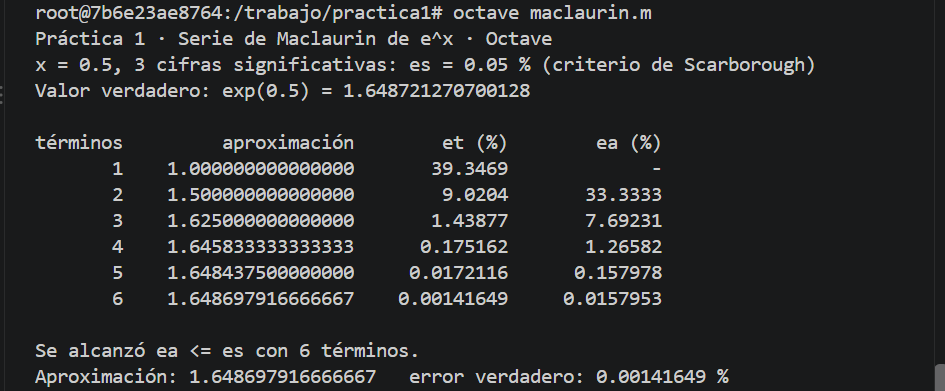
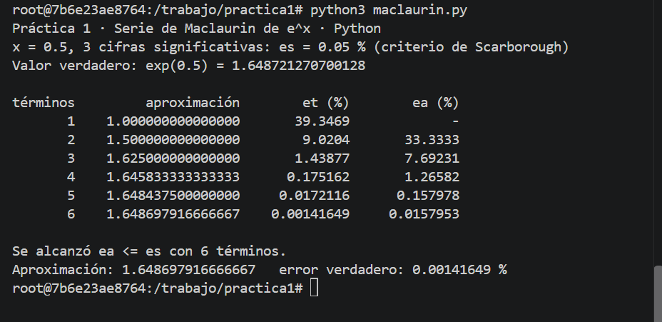
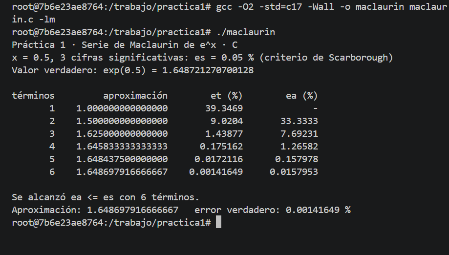

# Práctica 1 · La serie de Maclaurin y el criterio de paro

**UEA 1151039 · Métodos Numéricos en Ingeniería · Trimestre 26-O · UAM Azcapotzalco**
**Profesor:** M. en C. Gabriel Hurtado Avilés

| | |
|---|---|
| Alumno | Constanza Casales Avila |
| Matricula | 2253001260 |
| Licenciatura | Ingeniería Mecánica |
| Modalidad de elaboración | Individual |
| Fecha | Octubre 12, 2026|

## 1. Octave y Python

¿Coinciden con la lámina 25 de la unidad I?
Sí, los resultados de Octave y Python coinciden entre sí. Ambos programas obtienen la misma aproximación de (e^{0.5}), con el mismo número de términos y los mismos errores, por lo que se comprueba que realizan el mismo procedimiento.

## 2. Las dos líneas que completamos en `maclaurin.c`

termino = termino * X / n;
ea = fabs((aprox - anterior) / aprox) * 100.0;

## 3. Más cifras significativas

| Cifras | εs (%) | Términos | Aproximación | Error verdadero (%) |
|---|---|---|---|---|
| 3 | 0.05 | 6 | 1.648697916666667 | 0.00141649 |
| 6 | 0.00005 | 9 | 1.648721265035962 | 3.43549e-07 |
| 17 | 5e-16 | 16 | 1.648721270700128 | 2.69354e-14 |

Al finalizar las pruebas se regresó el valor a 3, que era el original.

1. ¿Cuántos términos hacen falta en cada caso?

Para 3 cifras significativas se necesitan 6 términos; para 6 cifras, 9 términos; y para 17 cifras, 16 términos. Al aumentar la precisión solicitada, generalmente se necesitan más términos de la serie para cumplir el criterio de paro.

2. En cada fila de la tabla, ¿εa es mayor o menor que εt? ¿Por qué conviene detenerse con εa?

Para 3 y 6 cifras significativas, el error aproximado relativo es mayor que el error verdadero. En cambio, para 17 cifras, el error aproximado llega a cero, mientras que el error verdadero sigue siendo distinto de cero. Esto ocurre porque dos aproximaciones consecutivas pueden representarse con el mismo valor en la computadora. Conviene utilizar εa como criterio de paro porque en problemas reales normalmente no se conoce el valor verdadero de la solución, pero sí se pueden comparar aproximaciones sucesivas.

3. Con 17 cifras el programa termina. ¿Cuántas cifras del resultado son correctas en realidad?
   Relaciónenlo con 0.1 + 0.2 de la Tarea 1.
   
Aunque se solicitan 17 cifras significativas, el resultado obtenido tiene aproximadamente 16 cifras significativas correctas. Esto se debe a que los números se representan con una precisión finita en la computadora. En la última iteración, el error aproximado es cero porque la nueva aproximación y la anterior se almacenan con el mismo valor, no porque el resultado sea exacto. 

Esto se relaciona con el caso de 0.1 + 0.2 de la Tarea 1, donde la representación binaria de los números decimales también puede producir pequeñas diferencias respecto al valor matemático esperado.

## Uso de inteligencia artificial

Se utilizó ChatGPT como herramienta de apoyo para las instrucciones de la práctica, revisar la redacción de las respuestas y organizar la información del reporte. La ejecución de los programas, las pruebas y la obtención de los resultados se realizaron en Visual Sudio Code en una terminal.

## Referencias

Chapra, S. C., & Canale, R. P. (2015). *Métodos Numéricos para Ingenieros* (7a ed.). McGraw-Hill. Capítulo 3,
ejemplo 3.2, y capítulo 4.
Burden, R. L., & Faires, J. D. (2011). *Análisis Numérico* (9a ed.). Cengage Learning. Capítulo 1.

