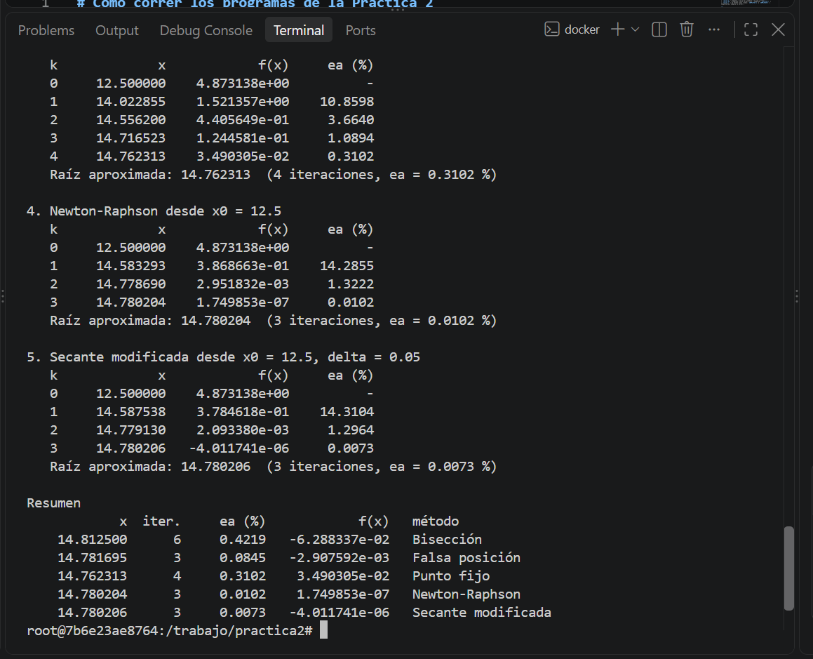
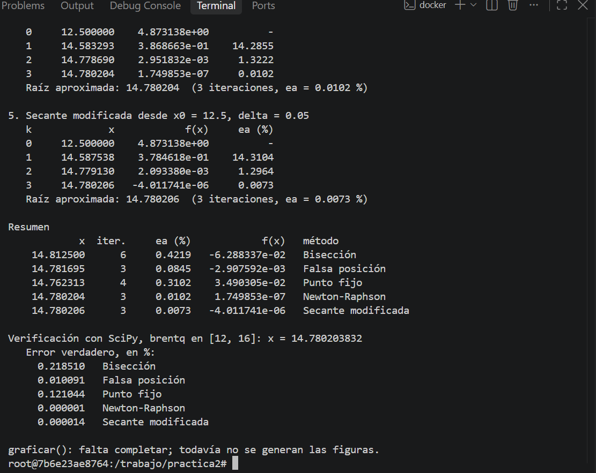
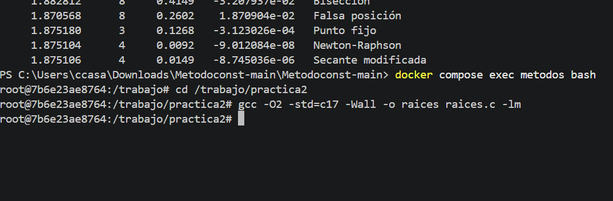
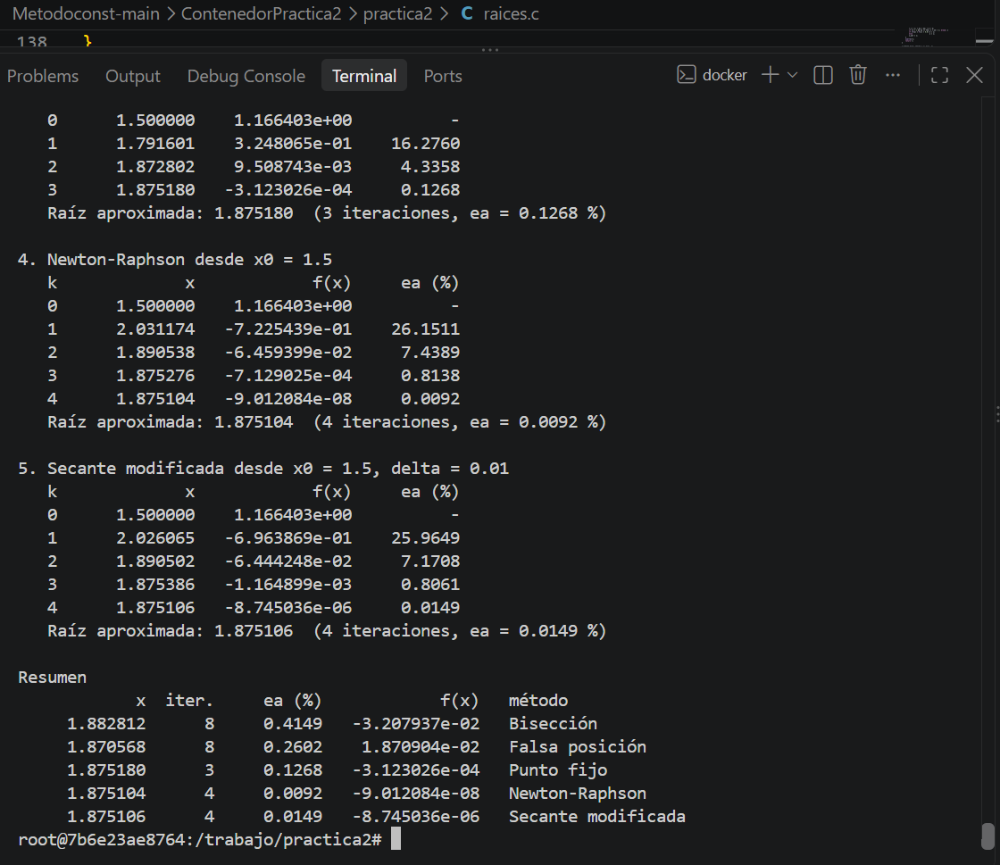
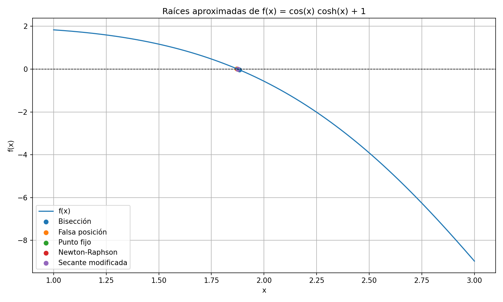
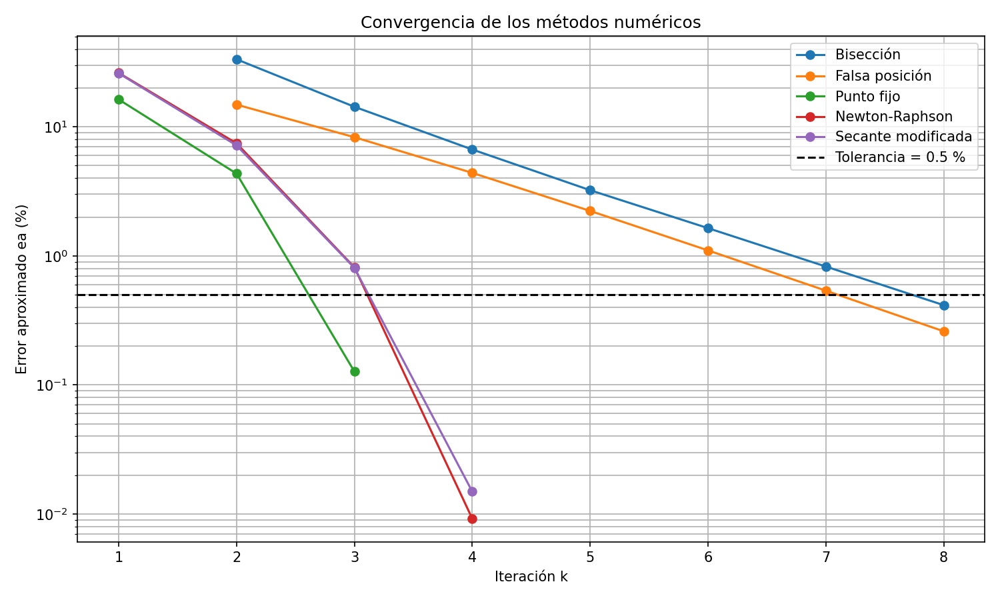
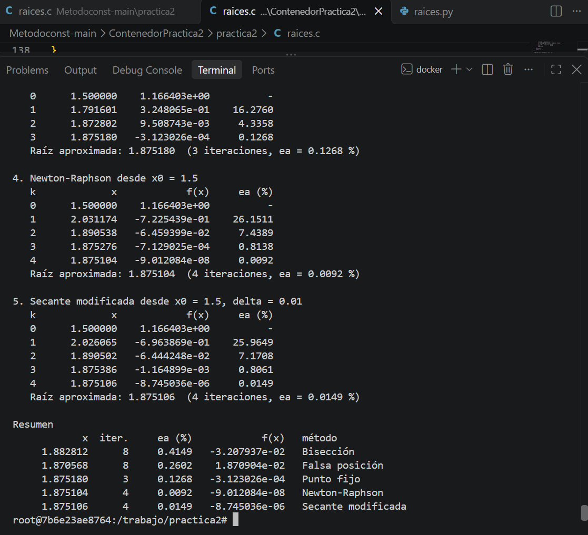
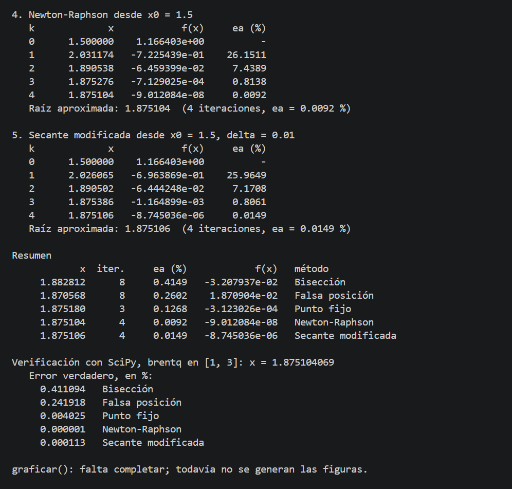
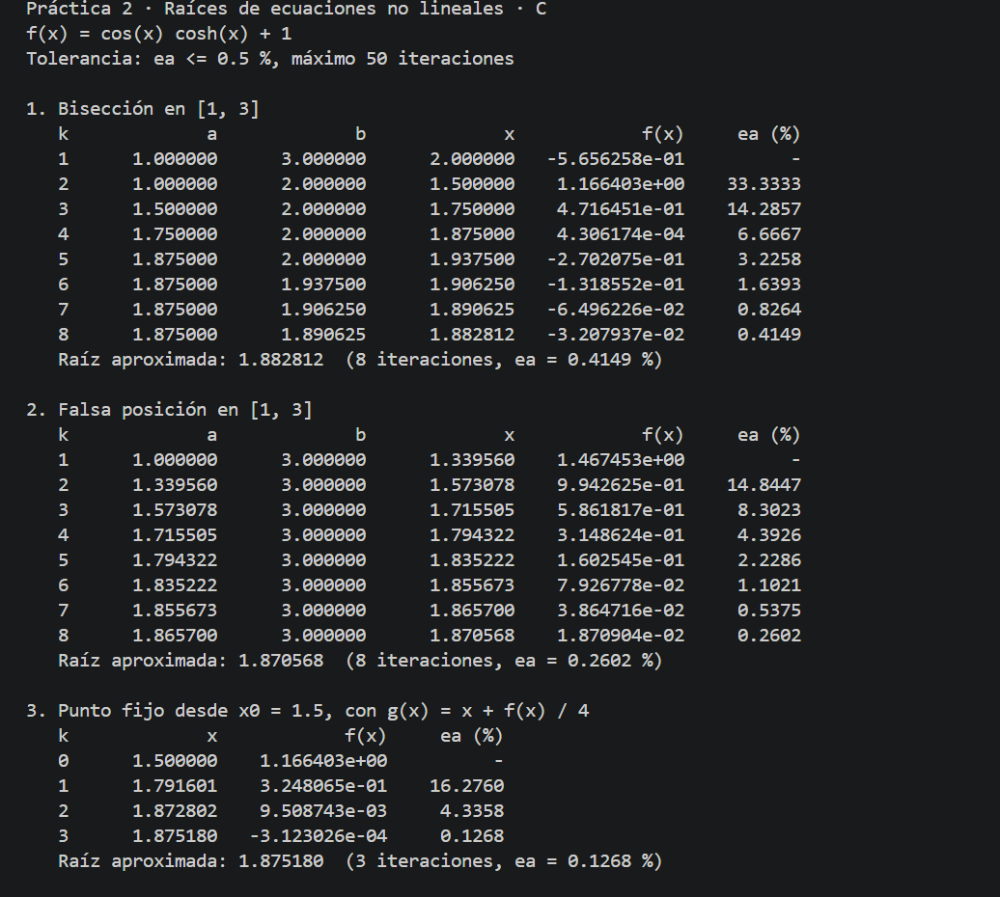

# Práctica 2 · Raíces de ecuaciones no lineales

**UEA 1151039 · Métodos Numéricos en Ingeniería · Trimestre 26-O · UAM Azcapotzalco**
**Profesor:** M. en C. Gabriel Hurtado Avilés

| | |
|---|---|
| Alumno | Casales Avila Constanza |
| Matricula | 2253001260 |
| Licenciatura | Ingeniería Mecánica |
| Ecuación asignada | 23. Vibración de un
voladizo |
| Fecha | Octubre 16, 2026 |

---

## 1. Octave y Python con el paracaidista

Capturas de `octave raices.m` y de `python3 raices.py` sin cambiar nada. Sus tablas
coinciden con las de las láminas de la unidad II.




## 2. Las cinco líneas que completamos en `raices.c`

```c
return fabs((nuevo - anterior) / nuevo) * 100.0; /* COMPLETAR 1 */
x = (a * f(b) - b * f(a)) / (f(b) - f(a)); /* COMPLETAR 2 */
x_nuevo = g(x); /* COMPLETAR 3 */
x_nuevo = x - f(x) / fp(x); /* COMPLETAR 4 */
x_nuevo = x - f(x) * delta / (f(x + delta) - f(x)); /* COMPLETAR 5 */
```




¿Coinciden las tablas de C con las de Octave y Python? Sí / No, y en qué. 

No completamente. Los programas originales de Octave y Python resuelven el problema del paracaidista, mientras que C se adaptó a la ecuación asignada al equipo. Por eso, sus resultados numéricos son diferentes. Los métodos y sus criterios de convergencia sí se pueden comparar.

## 3. Las gráficas de Python




## 4. Nuestra ecuación

| | |
|---|---|
| f(x) | cos(x)cosh(x) + 1 |
| f'(x) | -sin(x)cosh(x) + cos(x)sinh(x) |
| g(x) | x + f(x)/4 |
| Intervalo [a, b] | [1,3] |
| x₀ y δ | x₀ = 1.5,  δ = 0.01 |
| Tolerancia | εa ≤ 0.5 % |




### Tablas (salida de C)

**Bisección**

| k | a | b | x | f(x) | εa (%) |
|---|---|---|---|---|---|
| 1 | 1.000000 | 3.000000	| 2.000000 | -0.565626 | — |
| 2 | 1.000000 | 2.000000 | 1.500000 | 1.166403 | 33.3333 |
| 3 | 1.500000 | 2.000000 |	1.750000 | 0.471645 |	14.285 |
| 4 | 1.750000 | 2.000000 | 1.875000 | 0.000431 |	6.6667 |
| 5 | 1.875000 | 2.000000 | 1.937500 | -0.270208 | 3.2258 |
| 6 | 1.875000 | 1.937500	| 1.906250 | -0.131855 | 1.6393 |
| 7 | 1.875000 | 1.906250	| 1.890625 | -0.064962 | 0.8264 |
| 8 | 1.875000 | 1.890625	| 1.882812 | -0.032079 |0.4149 |

**Falsa posición**

| k | a | b | x | f(x) | εa (%) |
|---|---|---|---|---|---|
| 1 | 1.000000 | 3.000000	| 1.339560 | 1.467453	| — |
| 2 | 1.339560 | 3.000000	| 1.573078 | 0.994263	| 14.8447 |
| 3 |	1.573078 | 3.000000	| 1.715505 | 0.586182	| 8.3023 |
| 4 |	1.715505 | 3.000000	| 1.794322 | 0.314862 |	4.3926 |
| 5 |	1.794322 | 3.000000	| 1.835222 | 0.160255	| 2.2286 |
| 6 |	1.835222 | 3.000000	| 1.855673 | 0.079268	| 1.1021 |
| 7 |	1.855673 | 3.000000	| 1.865700 | 0.038647	| 0.5375 |
| 8 |	1.865700 | 3.000000	| 1.870568 | 0.018709	| 0.2602 |

**Punto fijo**

| k | x | f(x) | εa (%) |
|---|---|---|---|
| 0 | 1.500000 | 1.166403 | — |
| 1 | 1.791601 | 0.324807 |	16.2760 |
| 2 | 1.872802 | 0.009509 |	4.3358 |
| 3 | 1.875180 | -0.000312 | 0.1268 |

**Newton-Raphson**

| k | x | f(x) | εa (%) |
|---|---|---|---|
| 0 | 1.500000 | 1.166403 | — |
| 1 | 2.031174 | -0.722544 | 26.1511 |
| 2 | 1.890538 | -0.064594 | 7.4389 |
| 3 | 1.875276 | -0.000713 | 0.8138 |
| 4 | 1.875104 | -9.012084e-08 | 0.0092 |

**Secante modificada**

| k | x | f(x) | εa (%) |
|---|---|---|---|
| 0 | 1.500000 | 1.166403 | — |
| 1 | 2.026065 | -0.696387 | 25.9649 |
| 2 | 1.890502 | -0.064442 | 7.170 |
| 3 | 1.875386 | -0.001165 | 0.8061 |
| 4 | 1.875106 | -8.745036e-06 | 0.0149 |

Agreguen las filas que hagan falta.

### Resumen

| Método | Raíz | Iteraciones | εa (%) | f(raíz) | Error verdadero (%) |
|---|---|---|---|---|---|
| Bisección | 1.882812 | 8 | 0.4149 | -3.207937e-02 | 0.411094 |
| Falsa posición | 1.870568 | 8 | 0.2602 | 1.870904e-02 | 0.241918 |
| Punto fijo | 1.875180 | 3 | 0.1268 | -3.123026e-04 | 0.004025 |
| Newton-Raphson | 1.875104 | 4 | 0.0092 | -9.012084e-08 | 0.000001 |
| Secante modificada | 1.875106 | 4 | 0.0149 | -8.745036e-06 | 0.000113 |

Raíz de referencia (SciPy): 1.875104069

### Análisis

¿Qué método necesitó menos iteraciones y cuál más? ¿Por qué los cinco no dan
exactamente el mismo número? ¿Alguno no alcanzó la tolerancia o tardó mucho más que
los otros? ¿Por qué? 

El método de punto fijo necesitó menos iteraciones, con tres, mientras que bisección y falsa posición necesitaron ocho. Newton-Raphson y secante modificada convergieron en cuatro iteraciones. Los cinco métodos alcanzaron la tolerancia establecida de 0.5 %, aunque obtuvieron aproximaciones distintas porque cada uno utiliza un procedimiento diferente para calcular la siguiente iteración.

Al comparar los resultados con la raíz de referencia, Newton-Raphson obtuvo la aproximación más precisa, seguido por secante modificada. Bisección y falsa posición necesitaron más iteraciones y terminaron con aproximaciones menos cercanas a la raíz de referencia. Esto muestra que el error aproximado utilizado como criterio de paro no siempre coincide con el error verdadero.

## 5. Ejecución individual en mi computadora

Se compiló y ejecutó el programa raices.c en mi computadora utilizando la ecuación asignada a la práctica. La siguiente captura muestra la ejecución del programa y los resultados obtenidos por los cinco métodos numéricos.

| Alumna | Usuario de GitHub | Captura |
|---|---|---|
| Casales Avila Constanza | ccasalesa14 | `img/07-integrante-casales.png` |




## Uso de inteligencia artificial

Se utilizó ChatGPT como herramienta de apoyo para identificar errores durante la ejecución, verificar los resultados numéricos y organizar las tablas y el análisis de la práctica. Las modificaciones y pruebas se realizaron utilizando los programas de la práctica.

## Referencias

[1] Chapra, S. C., & Canale, R. P. (2015). *Métodos Numéricos para Ingenieros* (7a ed.). McGraw-Hill. Capítulos 5
y 6.
[2] Burden, R. L., & Faires, J. D. (2011). *Análisis Numérico* (9a ed.). Cengage Learning. Capítulo 2.
